# MSP Reports

A multi-tenant reporting platform for managed service providers. It pulls operational data from the PSA, RMM, security, backup and Microsoft 365 tools an MSP already runs. It maps each vendor's view of a customer onto one canonical customer record, then generates branded PDF reports and delivers them on a schedule by email or SharePoint.

| | |
|---|---|
| Backend | PHP 8.2+, Laravel 12, Sanctum, Laravel Queues, Reverb |
| Frontend | React 19, TypeScript 5.9, Vite 7, Tailwind CSS 3.4, Radix UI, Zustand, TanStack Query |
| Data | PostgreSQL 16 with TimescaleDB, Redis 7 |
| Rendering | Blade templates rendered to PDF by Gotenberg 8 |
| Matching | Python embedding service (Flask and Gunicorn) for fuzzy customer matching |
| Agents | PowerShell agents for on-premises Active Directory and Exchange |
| Deployment | Docker Compose (development), systemd and NGINX on Linux (production) |

---

## Contents

1. [Repository structure](#repository-structure)
2. [Features](#features)
3. [Architecture](#architecture)
4. [Use cases](#use-cases)
5. [Components](#components)
6. [Data flow](#data-flow)
7. [Key sequences](#key-sequences)
8. [State models](#state-models)
9. [Data model](#data-model)
10. [Deployment](#deployment)
11. [Getting started](#getting-started)
12. [Configuration](#configuration)
13. [API overview](#api-overview)
14. [Testing](#testing)
15. [Operations](#operations)
16. [Known limitations](#known-limitations)
17. [Contributing](#contributing)

---

## Repository structure

```text
.
├── agents/
│   └── windows_server/
│       ├── active-directory/      PowerShell AD sync agent, installer, modules
│       └── exchange/              PowerShell Exchange sync agent
├── backend/                       Laravel 12 application
│   ├── app/
│   │   ├── Actions/               Single-purpose use-case classes (ApiKey, Auth, Customer, Report, User, ...)
│   │   ├── Console/Commands/      Artisan commands: sync, audits, cleanup, diagnostics
│   │   ├── Enums/                 IntegrationStatus, ReportFrequency, UserStatus, AuthMethod
│   │   ├── Exceptions/            Integration and API exception types
│   │   ├── Http/
│   │   │   ├── Controllers/       Api/ and Admin/ controllers
│   │   │   ├── Middleware/        Auth, permission, tenancy scope, headers, timeouts
│   │   │   ├── Requests/          Form Request validation per endpoint
│   │   │   └── Resources/         JSON response transformers
│   │   ├── Integrations/          One directory per vendor connector + Contracts/
│   │   ├── Jobs/                  Queued sync, import, generation, delivery jobs
│   │   ├── Models/                Eloquent models and global scopes
│   │   ├── Reports/               One directory per report type + Contracts/
│   │   └── Services/              Domain services and delivery channels
│   ├── database/
│   │   ├── factories/
│   │   ├── migrations/            Including TimescaleDB hypertable and policy migrations
│   │   └── seeders/
│   ├── resources/views/Reports/   Blade templates rendered to PDF
│   ├── routes/                    api.php, web.php, console.php (schedule)
│   └── tests/                     PHPUnit Unit and Feature suites
├── frontend/                      React 19 + Vite SPA
│   ├── src/
│   │   ├── components/            Layout, UI primitives, shared modals
│   │   ├── contexts/              Auth and theme contexts
│   │   ├── hooks/                 Shared hooks
│   │   ├── lib/                   API client, Echo client, logger
│   │   ├── pages/                 Feature modules (integrations, customers, reports, ...)
│   │   ├── services/              Typed API wrappers
│   │   ├── stores/                Zustand stores
│   │   └── types/                 Shared TypeScript types
│   └── tests/e2e/                 Playwright specs
├── services/embedding/            Python embedding service for customer matching
├── nginx/                         Production and Docker NGINX configs
├── systemd/                       Worker, scheduler and embedding units
├── scripts/                       Setup, dev start and deploy scripts
├── docs/                          Deployment, runbook, encryption, reporting flow, API
├── docker-compose.yml             Development stack
└── CHANGELOG.md
```

---

## Features

### Integrations

There are 23 vendor connectors under `backend/app/Integrations`. Each one implements `IntegrationInterface` (`authenticate`, `sync`, `getCustomers`, `getHistoricalData`, `healthCheck`, `getRateLimits`, `getCredentialFields`, `getPreviewData`).

| Category | Connectors |
|---|---|
| PSA and documentation | Autotask, ITGlue |
| RMM and monitoring | Datto RMM, Kaseya, LibreNMS, Kemp |
| Security | BitDefender, ThreatLocker, RocketCyber, Barracuda, Sendmarc, Vonahi, WatchGuard AuthPoint, SAT |
| Backup | Veeam, Veeam ONE |
| Microsoft 365 | CIPP, M365, AdminDroid, SharePoint, SaaS licensing |
| On-premises (agent push) | Active Directory, Exchange |

Each connector provides:

- Credentials stored with Laravel encrypted casts.
- Per-integration rate limits.
- Scheduled incremental sync and on-demand sync.
- Historical backfill jobs with stuck-job detection.
- Health checks and a live data preview before a report is configured.

### Customer mapping

- One canonical `Customer` per real-world client, linked to many `IntegrationCustomer` records through `CustomerMapping`.
- A company can designate one integration as the source of truth for its customer list.
- Exact-name auto-match, plus embedding-based smart-match suggestions with a configurable similarity threshold.
- Manual map, merge, split and unmap operations, all audit logged.

### Reports

There are 17 report types under `backend/app/Reports`. Each one implements `ReportInterface` (`getRequiredDataTypes`, `validate`, `generate`, `getTemplate`).

- **Report types:** Autotask Summary, Ticket Summary, Datto RMM Summary, BitDefender Summary, ThreatLocker Summary, CIPP Summary, ITGlue Summary, LibreNMS Summary, LibreNMS Device Report, Sendmarc Summary, Vonahi Summary, SaaS Summary, SPLA Licensing, Backup Status, Uptime Report, Security Summary, Monthly Comprehensive.
- **Schedules:** daily, weekly, monthly, yearly or on demand, evaluated in each customer's own time zone.
- **Templates:** reusable bundles of report types, applied to one customer or many.
- **Delivery:** email or SharePoint upload. Time-limited share links can be issued for one-off access.
- **Branding:** logo, colours and report file naming are set per company.

### Access control and security

- **Sign-in:** local passwords, Microsoft Entra ID (OAuth), Keycloak (OIDC), SAML 2.0 and LDAP.
- **Roles:** five built-in roles (`admin`, `manager`, `technician`, `viewer`, `customer`), each with resource and action permissions that can be overridden per user.
- **Tenancy:** queries are scoped by company, and customer access is scoped per user.
- **Sessions and headers:** idle-session timeout, rate limiting on authentication routes, and secure response headers.
- **API keys:** SHA-256 hashed keys for agents and machine clients, which can be revoked.
- **Audit log:** filterable and exportable, with retention-based cleanup.

### Operations

- Health endpoints for the database, Redis, mail, scheduler, storage, reports and external dependencies.
- Monitoring views for queue depth, integration sync metrics and report throughput.
- An alert rule engine that is evaluated every five minutes.
- Licence enforcement for integration count, user count and data retention.

---

## Architecture

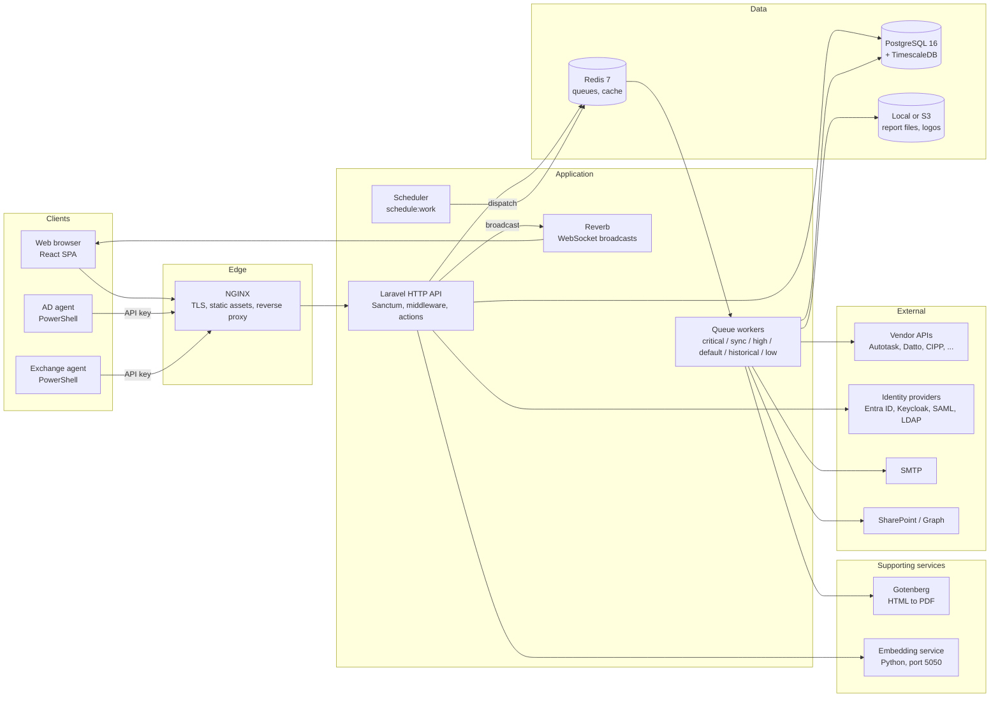

### Design principles

- **Plugin-style extension.** Integrations and reports are discovered from their directories, and each lives in its own namespace with a `config.php`. Adding a connector means adding a directory. No central registry needs editing.
- **Thin controllers, explicit actions.** Controllers validate input through Form Requests and delegate to single-purpose classes in `app/Actions`. Cross-cutting logic lives in `app/Services`.
- **Asynchronous by default.** Syncs, historical imports, report generation and delivery run on prioritised Redis queues, so the HTTP layer never waits on a vendor API.
- **Time-series storage.** Raw integration payloads land in `integration_data`, a TimescaleDB hypertable with compression and retention policies.

---

## Use cases

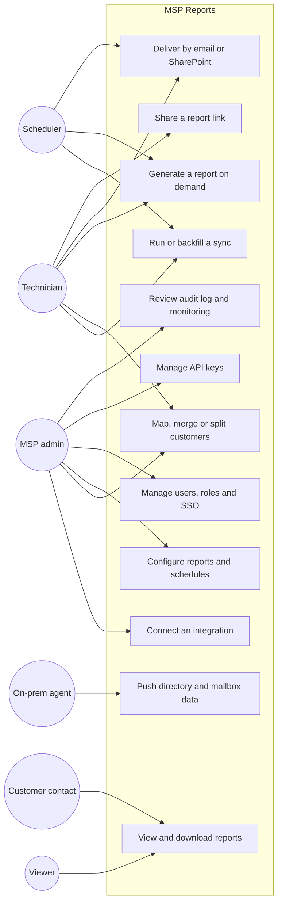

| Actor | Primary goals |
|---|---|
| MSP admin | Onboard vendors, set the source of truth, define templates and schedules, manage staff access and SSO. |
| Technician | Keep data fresh, resolve mapping mismatches, produce and send reports. |
| Viewer / Customer | Read and download reports within their permitted customers. |
| On-prem agent | Push Active Directory and Exchange inventory over an API key. |
| Scheduler | Drive recurring syncs, report runs, alert evaluation and data cleanup. |

---

## Components

### Backend

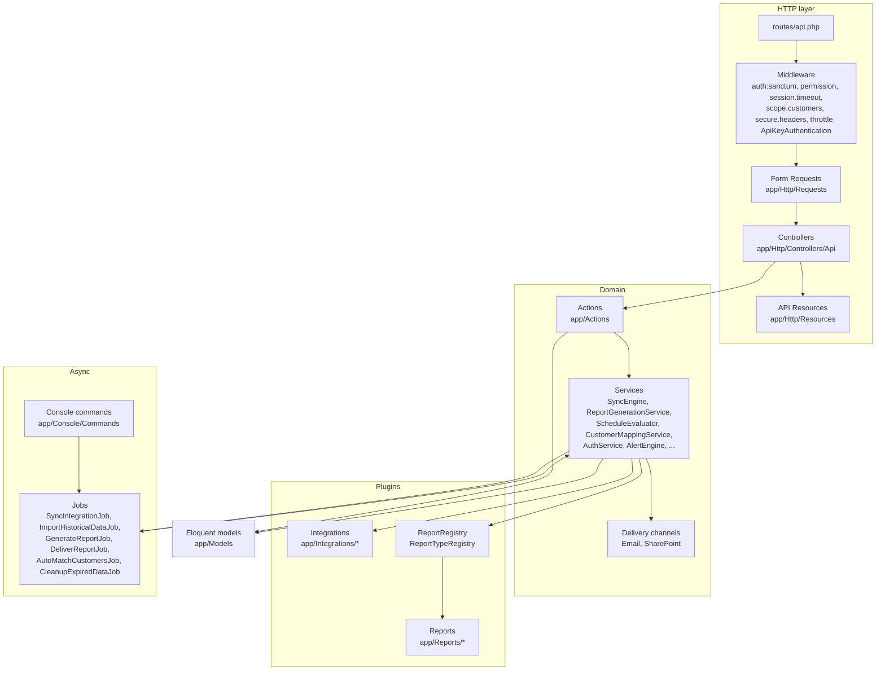

### Frontend

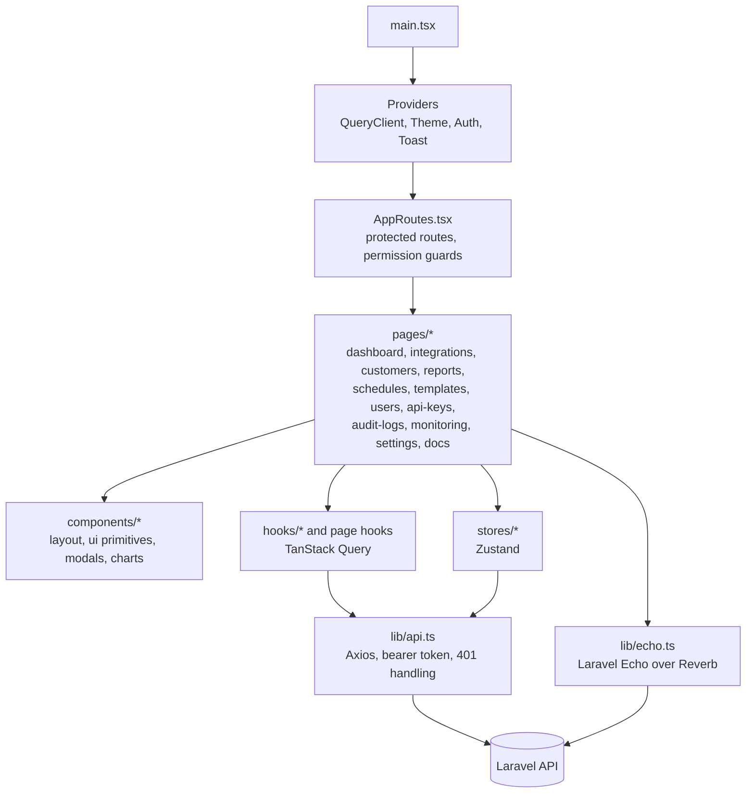

---

## Data flow

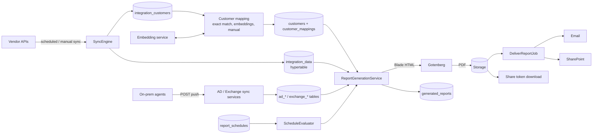

1. **Ingest.** Connectors pull customers and metrics into `integration_customers` and `integration_data`. Agents push directory and mailbox inventory instead of being polled.
2. **Resolve.** Integration customers are mapped to canonical customers, either automatically or by a technician.
3. **Aggregate.** A report's data gatherer reads every mapped integration for the customer over the reporting period.
4. **Render.** A Blade template is rendered to HTML, converted to PDF by Gotenberg, and stored.
5. **Distribute.** The PDF is delivered through the customer's configured channel, or exposed through a share link.

---

## Key sequences

### Sign-in (local credentials)

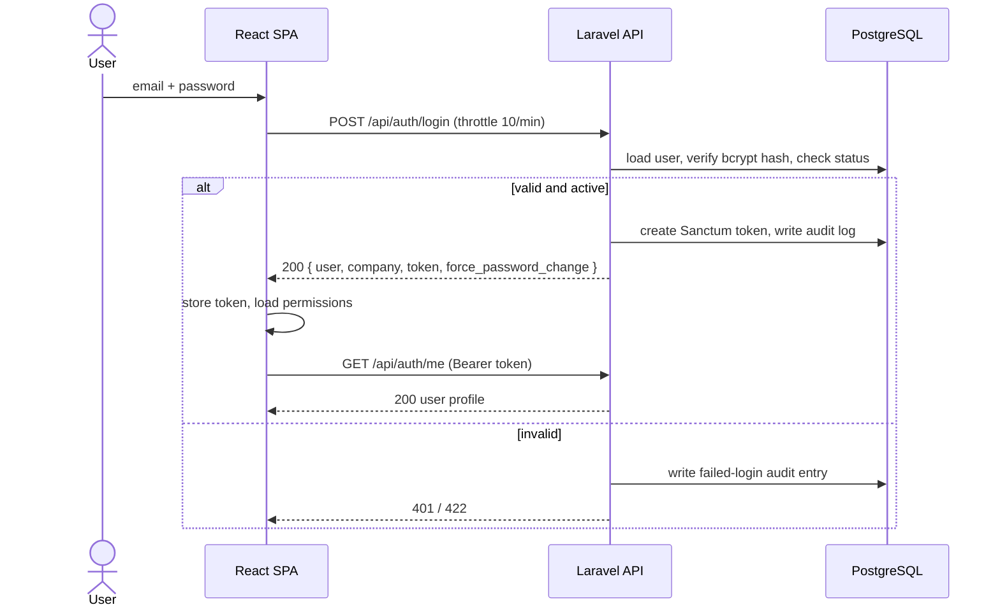

### Integration sync

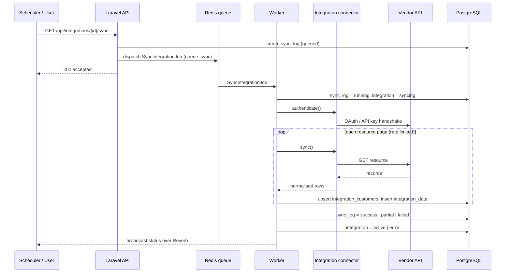

### Scheduled report generation and delivery

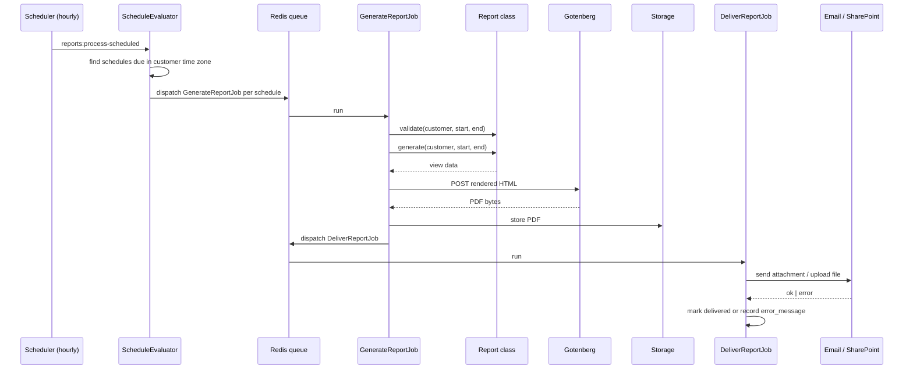

### Agent push (Active Directory)

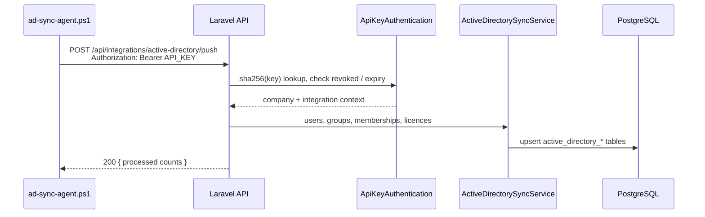

---

## State models

### Integration status (`App\Enums\IntegrationStatus`)

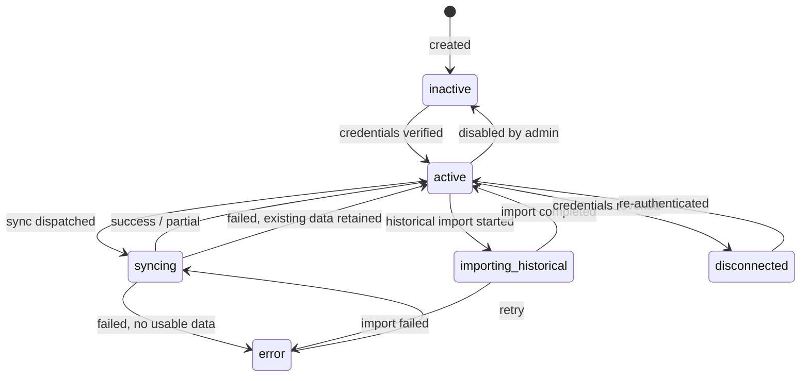

### Sync log

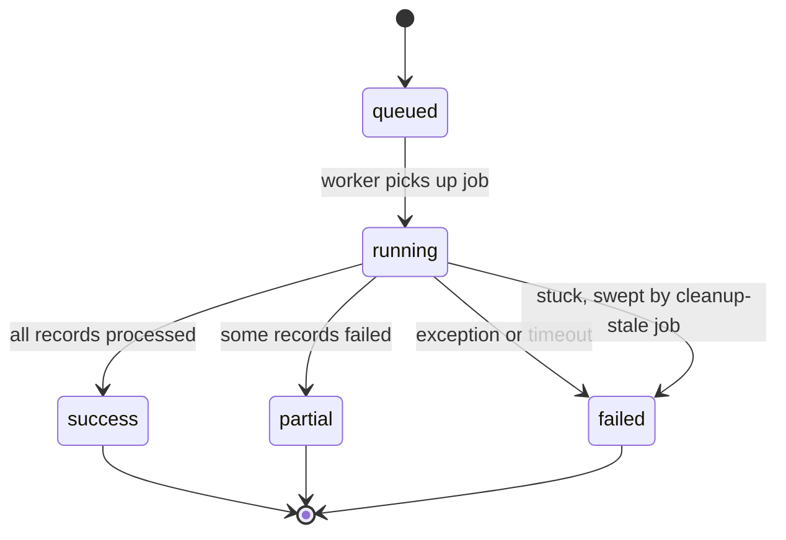

### Generated report

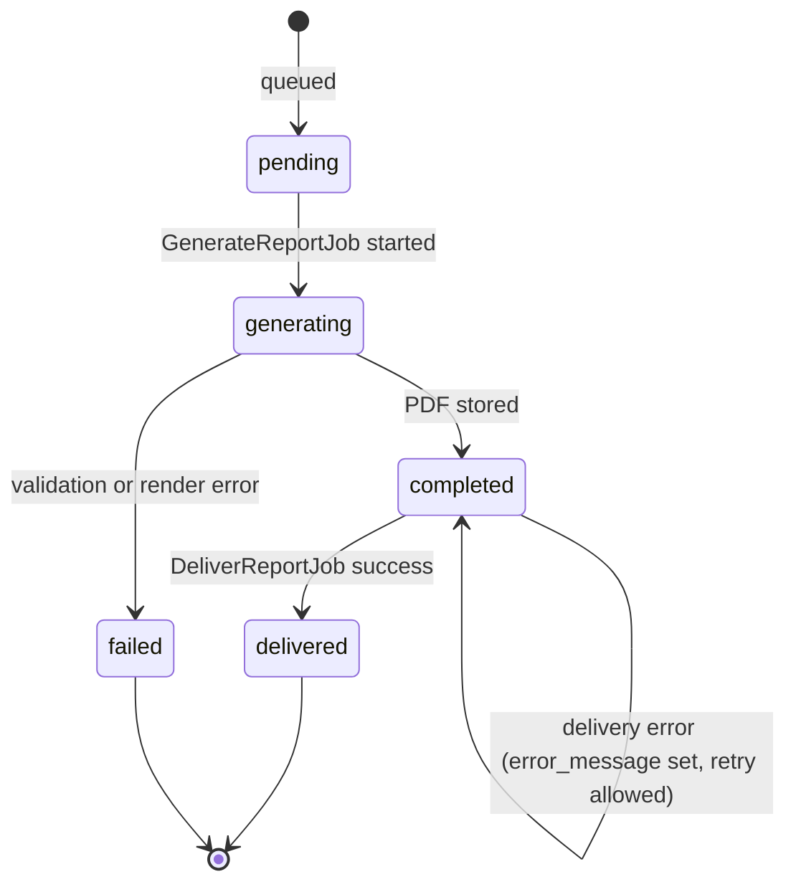

`delivered` is a boolean flag on a `completed` report, not a separate enum value.

### User account (`App\Enums\UserStatus`)

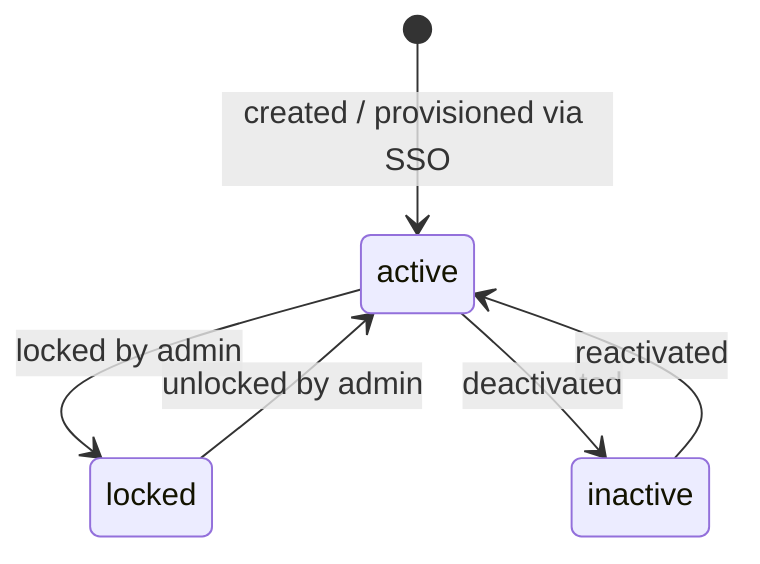

---

## Data model

The core entities are shown below. Agent-specific tables (`active_directory_*` and `exchange_*`) are omitted.

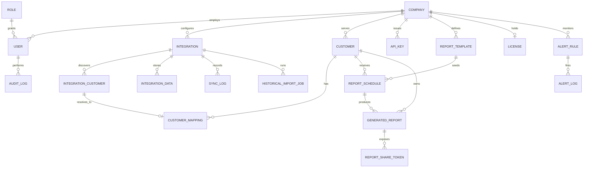

---

## Deployment

### Production (Linux, native)

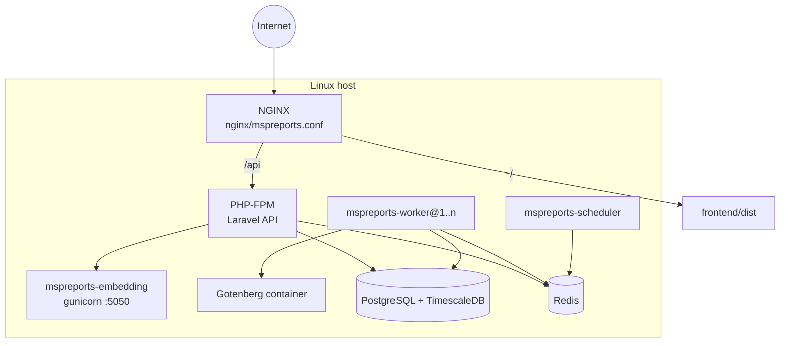

The systemd units live in `systemd/` and are grouped under `mspreports.target`. See [docs/DEPLOYMENT_NATIVE.md](docs/DEPLOYMENT_NATIVE.md) and [docs/PRODUCTION_RUNBOOK.md](docs/PRODUCTION_RUNBOOK.md).

### Development (Docker Compose)

| Service | Purpose | Port |
|---|---|---|
| `backend` | `php artisan serve` | 8082 |
| `queue-critical` (2 replicas) | Worker for `critical,high,sync` queues | none |
| `queue-historical` (3 replicas) | Worker for `historical,default,low` queues | none |
| `scheduler` | `php artisan schedule:work` | none |
| `frontend` | Vite dev server | 5173 |
| `gotenberg` | PDF rendering | 3001 |
| `postgres` | PostgreSQL 16 | 5433 |
| `redis` | Redis 7 | 6380 |

---

## Getting started

### Prerequisites

- PHP 8.2+ (production targets 8.3 FPM) with `pdo_pgsql`, `redis`, `ldap`, `gd`, `zip` and `intl`
- Composer 2
- Node.js 20 LTS and npm
- PostgreSQL 16 (TimescaleDB 2.x recommended; required for compression and retention policies)
- Redis 7
- Docker, for Gotenberg (and optionally for the whole stack)
- Python 3.10+, only if you run the embedding service

### Option A: Docker Compose

```bash
git clone https://github.com/oyedokunken/MSP-reports.git
cd MSP-reports
cp backend/.env.example backend/.env.docker   # set DB_HOST=postgres, REDIS_HOST=redis, GOTENBERG_URL=http://gotenberg:3000
docker compose up -d --build
docker compose exec backend php artisan key:generate
docker compose exec backend php artisan migrate --seed
```

The SPA is served at `http://localhost:5173` and the API at `http://localhost:8082/api`.

Note: `docker-compose.yml` currently hardcodes a developer LAN address (`192.168.9.85`) and uses the plain `postgres:16` image. Replace the address with `localhost`, and switch to `timescale/timescaledb:latest-pg16` if you need the hypertable migrations to apply.

### Option B: Local toolchain

Run the helper script for your platform (`scripts/setup-local.sh` or `scripts/setup-local.ps1`), or set things up manually:

```bash
# Backend
cd backend
cp .env.example .env            # set DB_*, REDIS_*, GOTENBERG_URL
composer install
php artisan key:generate
php artisan migrate --seed
php artisan serve --port=8000

# Workers and scheduler (separate terminals)
php artisan queue:work redis --queue=critical,sync,high,default,historical,low
php artisan schedule:work

# PDF renderer
docker run -d -p 3000:3000 gotenberg/gotenberg:8

# Frontend
cd ../frontend
cp .env.example .env            # VITE_API_BASE_URL=/api, VITE_BACKEND_URL=http://localhost:8000
npm ci
npm run dev
```

`scripts/start-dev.sh` and `scripts/start-dev.ps1` start the backend, workers, scheduler and frontend together.

### Optional: embedding service

```bash
cd services/embedding
python -m venv .venv && source .venv/bin/activate
pip install -r requirements.txt
gunicorn -w 2 -b 127.0.0.1:5050 embedding_service:app
```

Then set `EMBEDDING_SERVICE_ENABLED=true` and `EMBEDDING_SERVICE_URL=http://127.0.0.1:5050` in `backend/.env`.

---

## Configuration

All backend configuration is read from `backend/.env`. See `backend/.env.example` for the full list. The groups that matter most:

| Group | Variables | Notes |
|---|---|---|
| Application | `APP_KEY`, `APP_ENV`, `APP_DEBUG`, `APP_URL`, `FRONTEND_URL`, `APP_TIMEZONE` | `APP_DEBUG` must be `false` in production. |
| Database | `DB_CONNECTION=pgsql`, `DB_HOST`, `DB_PORT`, `DB_DATABASE`, `DB_USERNAME`, `DB_PASSWORD` | |
| Queue and cache | `QUEUE_CONNECTION=redis`, `CACHE_STORE`, `REDIS_HOST`, `REDIS_PASSWORD` | `database` queue works for development only. |
| Broadcasting | `BROADCAST_CONNECTION=reverb`, `REVERB_APP_ID`, `REVERB_APP_KEY`, `REVERB_APP_SECRET` | Replace the example key and secret. |
| CORS and sessions | `CORS_ALLOWED_ORIGINS`, `SESSION_LIFETIME`, `SESSION_SECURE_COOKIE` | |
| Mail | `MAIL_MAILER`, `MAIL_HOST`, `MAIL_PORT`, `MAIL_USERNAME`, `MAIL_PASSWORD`, `MAIL_FROM_ADDRESS` | Used for report delivery and password resets. |
| PDF | `GOTENBERG_URL`, `GOTENBERG_TIMEOUT`, `GOTENBERG_ENABLED` | |
| Matching | `EMBEDDING_SERVICE_URL`, `EMBEDDING_SERVICE_ENABLED`, `EMBEDDING_SIMILARITY_THRESHOLD` | |
| Keycloak SSO | `KEYCLOAK_ENABLED`, `KEYCLOAK_BASE_URL`, `KEYCLOAK_REALM`, `KEYCLOAK_CLIENT_ID`, `KEYCLOAK_CLIENT_SECRET`, `KEYCLOAK_REDIRECT_URI` | Read by `config/services.php`; not yet listed in `.env.example`. |
| Microsoft SSO | `AZURE_CLIENT_ID`, `AZURE_CLIENT_SECRET`, `AZURE_TENANT_ID`, `AZURE_REDIRECT_URI`, `OAUTH_ENABLED`, `OAUTH_AUTO_PROVISION` | |
| SAML | `SAML_ENABLED`, `SAML_IDP_*`, `SAML_SP_*`, `SAML_ATTR_*`, `SAML_STRICT_MODE` | Keep `SAML_STRICT_MODE=true` and `SAML_DEBUG=false` in production. |
| LDAP | `LDAP_HOST`, `LDAP_PORT`, `LDAP_BASE_DN`, `LDAP_USERNAME`, `LDAP_PASSWORD`, `LDAP_SSL`, `LDAP_TLS` | |
| Storage | `FILESYSTEM_DISK`, `AWS_*` | Use `s3` for multi-node deployments. |

Integration credentials are not environment variables. They are entered in the UI per company and stored encrypted.

Never commit a real `.env`. Only `*.env.example` files are tracked.

---

## API overview

All endpoints are served under `/api` and return JSON.

- **Browser clients** authenticate with a Sanctum bearer token from `POST /api/auth/login` or an SSO callback.
- **Agents** authenticate with an API key sent as a bearer token.
- **Rate limits:** 300 requests per minute per client, 10 per minute on credential endpoints, and 30 per minute on public share downloads.
- **Permissions:** every authenticated route also checks `permission:<resource>,<action>` against the user's effective permissions.

| Area | Base path | Representative endpoints | Permission |
|---|---|---|---|
| Health | `/health` | `GET /health`, `GET /health/database`, `GET /health/redis` | public |
| Auth | `/auth` | `POST /auth/login`, `POST /auth/logout`, `GET /auth/me`, `POST /auth/password/change`, `GET /auth/microsoft/redirect`, `POST /auth/saml/acs` | public or token |
| Company | `/company` | `GET/PATCH /company/settings`, `PATCH /company/branding`, `POST /company/logo/upload` | token |
| Users | `/users` | `GET /users`, `POST /users`, `PATCH /users/{id}`, `PATCH /users/{id}/permissions`, `DELETE /users/{id}` | `users.view`, `users.manage` |
| Integrations | `/integrations` | `GET /integrations`, `POST /integrations`, `GET /integrations/{id}/sync`, `POST /integrations/{id}/historical-import`, `GET /integrations/{id}/preview` | `integrations.*` |
| Agent push | `/integrations/{active-directory,exchange}` | `POST .../push`, `GET .../status` | API key |
| Customers | `/customers` | `GET /customers`, `POST /customers/map`, `POST /customers/{id}/merge`, `POST /customers/{id}/split`, `POST /customers/smart-match` | `customers.*` |
| Report config | `/reports`, `/customers/{id}/reports` | `GET /reports`, `PATCH /customers/{id}/reports`, `POST /reports/generate/{customer_id}`, `POST /reports/bulk-generate` | `reports.*` |
| Report history | `/reports` | `GET /reports/history`, `GET /reports/{id}/download`, `POST /reports/{id}/email`, `POST /reports/{id}/share` | `reports.*` |
| Delivery | `/delivery`, `/customers/{id}/delivery` | `GET /delivery/methods`, `PATCH /customers/{id}/delivery`, `POST /customers/{id}/delivery/test` | `reports.*` |
| Templates | `/report-templates` | CRUD, `POST /report-templates/{t}/apply-to-customers` | `templates.*` |
| API keys | `/api-keys` | `GET`, `POST`, `POST /{id}/revoke`, `DELETE /{id}` | `api_keys.*` |
| Licences | `/licenses` | `GET /licenses`, `GET /licenses/usage` | `licenses.*` |
| Notifications | `/notifications` | `GET`, `PATCH /{id}/read`, `POST /mark-all-read` | `notifications.view` |
| Monitoring | `/monitoring`, `/audit-logs` | `GET /monitoring/queue`, `GET /audit-logs`, `GET /audit-logs/export` | `monitoring.view`, `security.view_logs` |

The complete endpoint reference, with request and response shapes, is in [docs/API.md](docs/API.md).

Example:

```bash
TOKEN=$(curl -s -X POST http://localhost:8000/api/auth/login \
  -H 'Content-Type: application/json' \
  -d '{"email":"admin@example.com","password":"<password>","auth_method":"local"}' | jq -r .data.token)

curl -s http://localhost:8000/api/integrations -H "Authorization: Bearer $TOKEN"
```

---

## Testing

```bash
# Backend (PHPUnit)
cd backend
php artisan test
php artisan test --filter=CustomerMappingTest

# Frontend unit tests (Vitest)
cd frontend
npm test -- --run

# Frontend type check and lint
npx tsc -p tsconfig.app.json --noEmit
npm run lint

# End-to-end (Playwright)
npm run test:e2e
```

The backend suite has 84 test methods. `phpunit.xml` runs against in-memory SQLite, so the `pdo_sqlite` extension is required, and migrations that use TimescaleDB or PostgreSQL-specific SQL do not apply cleanly under SQLite. The frontend has 33 unit tests and 2 end-to-end tests. Static analysis is available through `./vendor/bin/phpstan analyse` (Larastan) and formatting through `./vendor/bin/pint`.

---

## Operations

### Scheduled tasks (`backend/routes/console.php`)

| Command | Frequency | Purpose |
|---|---|---|
| `integrations:monitor` | every minute | Dispatch integration syncs that are due |
| `alerts:evaluate` | every 5 minutes | Evaluate alert rules |
| `imports:check-stuck --fix` | every 30 minutes | Recover stalled historical imports |
| `reports:process-scheduled` | hourly | Generate and deliver due reports |
| `syncs:cleanup-stale` | hourly | Fail sync logs stuck in `running` |
| `integrations:sync-recent-data --days=7` | daily 01:00 | Re-sync the trailing week |
| `data:cleanup` | daily 02:00 | Enforce data retention |
| `reports:cleanup` | daily 03:00 | Remove expired report files |
| `audit:cleanup 90` | daily 04:30 | Trim audit log to 90 days |

### Queues

| Queue | Workload |
|---|---|
| `critical` | User-initiated generation and delivery |
| `sync` | Integration syncs |
| `high` | Customer matching |
| `default` | General jobs |
| `historical` | Historical backfills (long timeout) |
| `low` | Cleanup and maintenance |

### Useful commands

```bash
php artisan integration:list
php artisan integrations:sync {id}
php artisan reports:list
php artisan reports:generate-manual
php artisan apikey:create
php artisan customers:auto-match
```

Run `php artisan list` for the full set, including the per-vendor `reports:audit-*` verification commands.

---

## Known limitations

These items are tracked for remediation and are intentionally listed here rather than hidden.

- **The backend test suite needs a PostgreSQL test database.** Under SQLite most feature tests fail on migrations. Tenancy isolation, permission middleware and most integrations have no automated tests.
- **No CI on the current remote.** `.gitlab-ci.yml` targets the original GitLab instance, and no GitHub Actions workflow exists yet.
- **Bearer tokens are kept in browser storage.** A move to httpOnly cookie sessions through Sanctum SPA mode is planned.
- **Several diagnostic commands** (`Test*`, `Fix*`, `ForceFail*`, `Benchmark*`) still ship in `app/Console/Commands` and should move behind a development-only provider.
- **The Exchange UI module is incomplete** and its routes are disabled.

---

## Contributing

1. Branch from `main` using `feat/`, `fix/` or `chore/` prefixes.
2. Follow [Conventional Commits](https://www.conventionalcommits.org) for commit messages.
3. Add or update tests for any behaviour change. `php artisan test`, `npm test -- --run`, `npx tsc --noEmit` and `npm run lint` must pass.
4. Open a pull request with a description of the change and how it was verified.

See [CONTRIBUTING.md](CONTRIBUTING.md) for details.

## Licence

No licence file is included. All rights are reserved by the copyright holder. Do not redistribute without permission.
